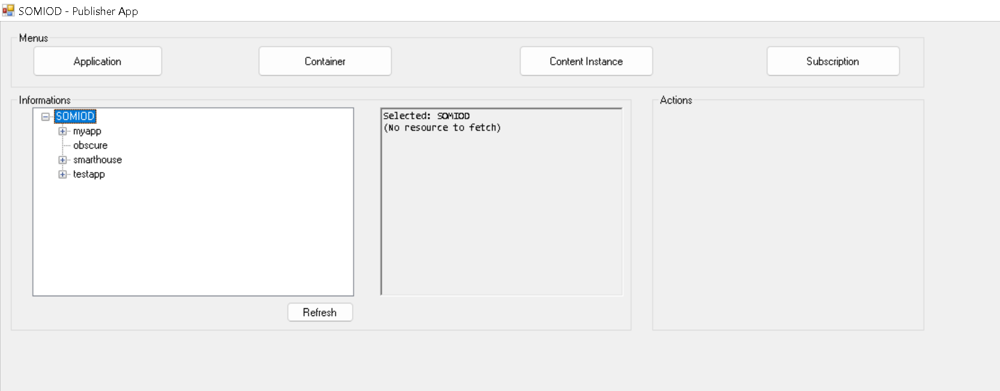
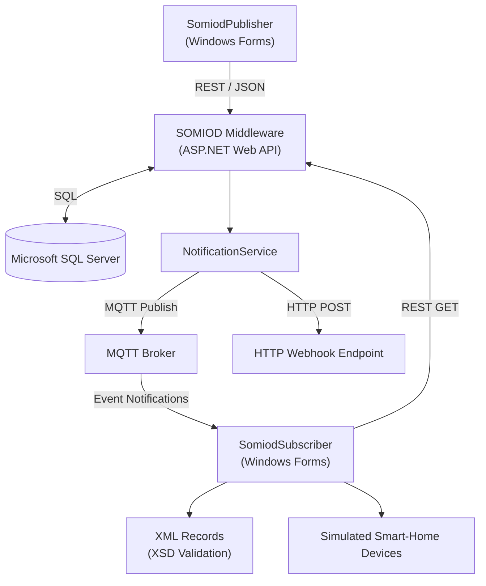
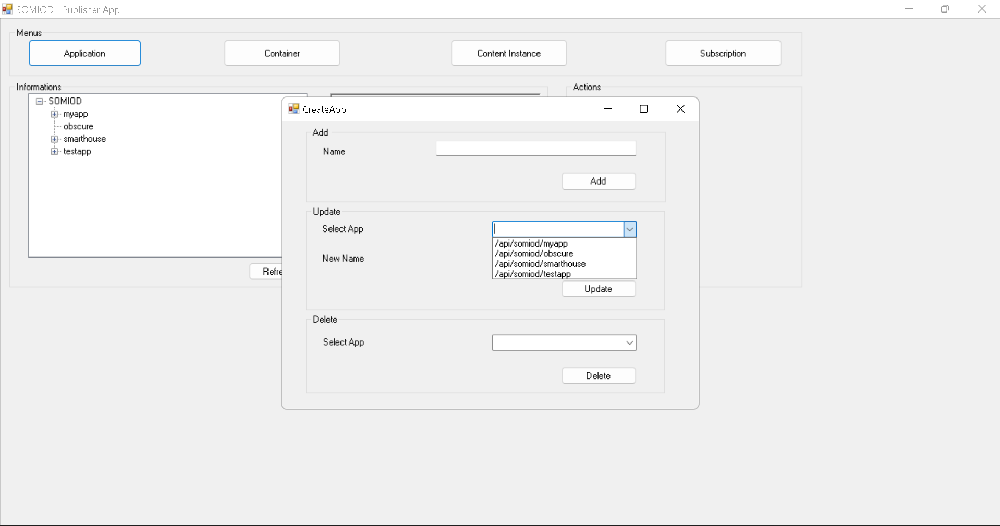
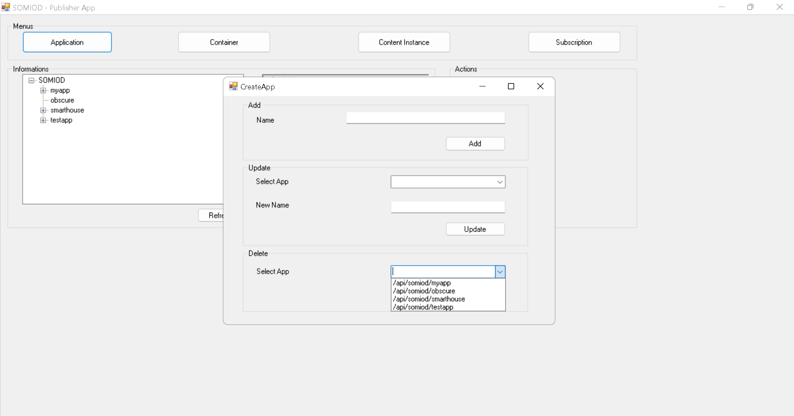
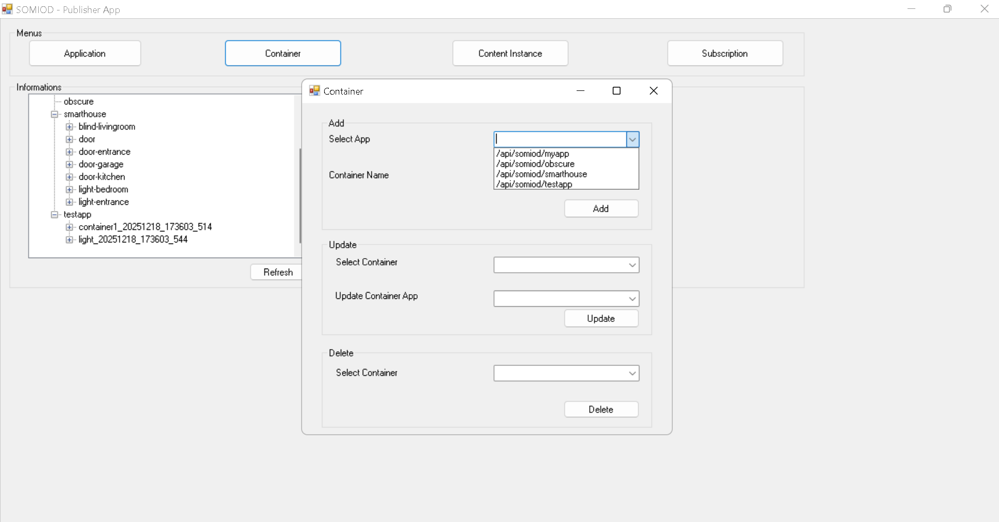
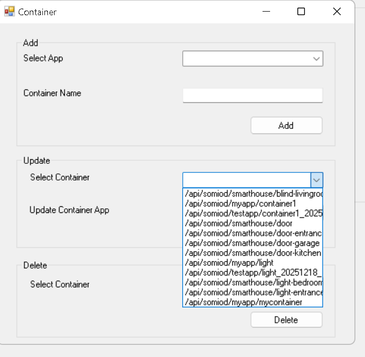
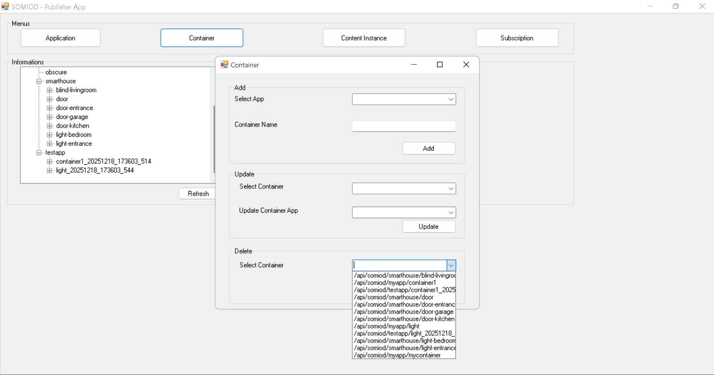
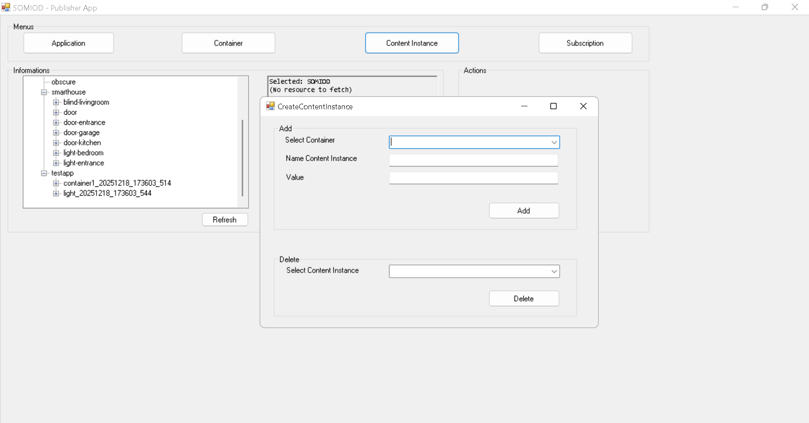
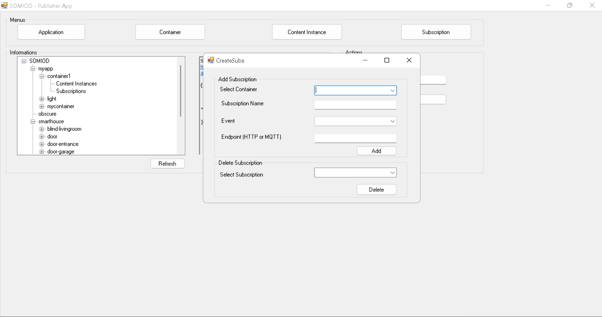
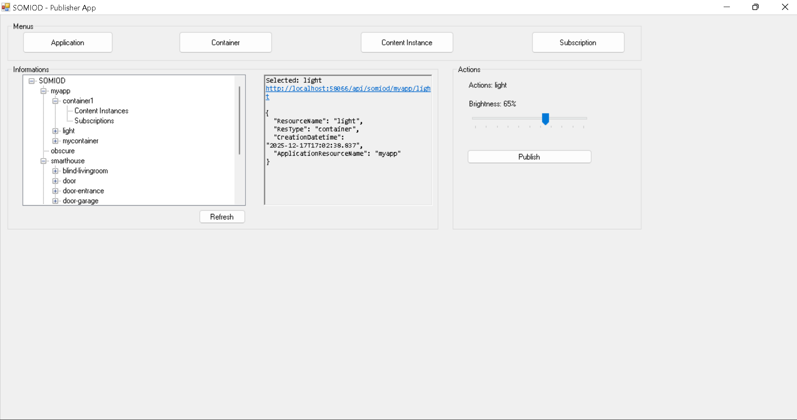

<div align="center">

# 🌐 SOMIOD — IoT Middleware

### Service-Oriented Middleware for Interoperability and Open Data


[](LICENSE)

</div>

---

## 📖 Overview

**SOMIOD (Service-Oriented Middleware for Interoperability and Open Data)** is an IoT middleware developed in **C# using ASP.NET Web API (.NET Framework 4.8)**, with **Microsoft SQL Server** for persistent storage.

The project addresses interoperability challenges in IoT environments by providing a centralized service for managing resources and exchanging information between applications.

SOMIOD combines a **RESTful API** with event-driven notifications delivered through **HTTP webhooks and MQTT**, following a service-oriented architecture.

The solution also includes two Windows Forms applications, **SomiodPublisher** and **SomiodSubscriber**, which demonstrate resource management and event-driven communication through a simulated smart-home environment.

> 🎓 **Academic Project**
>
> Developed to explore IoT interoperability, service-oriented architectures, REST API development, relational databases, and event-driven communication.

---

## 🖥️ Application Preview



*Publisher interface for browsing and managing IoT resources through the SOMIOD middleware.*

---

## 🎯 Project Objectives

The main objective is to provide a standardized communication layer between IoT applications, reducing the need for direct integration between individual components.

The project focuses on:

- **Interoperability:** Provide a common RESTful interface for IoT applications.
- **Resource Management:** Organize IoT resources using a hierarchical model.
- **Data Persistence:** Store and retrieve resources using Microsoft SQL Server.
- **Event-Driven Communication:** Deliver notifications through HTTP and MQTT.
- **Resource Discovery:** Discover resources using a custom HTTP header.
- **Data Validation:** Validate and persist notification records using XML/XSD.
- **Practical Demonstration:** Simulate smart-home devices through dedicated Publisher and Subscriber applications.


---

## 🏗️ System Architecture

SOMIOD follows a service-oriented architecture that enables communication between IoT applications through a centralized RESTful API and an event-driven notification system.

The architecture consists of the middleware, a SQL Server database, HTTP/MQTT notification services, and two Windows Forms demonstration clients.



### Architecture Components

- **SomiodPublisher:** Windows Forms client responsible for managing resources and publishing device commands through REST requests.
- **SOMIOD Middleware:** ASP.NET Web API that manages the hierarchical resource model, processes requests, and handles subscriptions.
- **Microsoft SQL Server:** Relational database used to persist applications, containers, content instances, and subscriptions.
- **NotificationService:** Processes supported resource events and distributes notifications through HTTP or MQTT.
- **MQTT Broker:** Enables asynchronous communication between the middleware and subscribed clients.
- **HTTP Webhooks:** Allow event notifications to be delivered to registered HTTP endpoints.
- **SomiodSubscriber:** Windows Forms client that receives MQTT notifications, retrieves resource information, and processes supported device commands.
- **XML/XSD:** Used by the Subscriber to validate and store notification records.
- **Simulated Smart-Home Devices:** Graphical representations of lights, doors, and blinds controlled through received commands.


---

## ✨ Features

- **Resource hierarchy** — `Application` → `Container` → `Content Instance`, plus `Subscription` resources attached to containers.
- **Discovery via custom HTTP header** — clients send `somiod-discovery: <resource-type>` to list children of any resource in the hierarchy.
- **RESTful resource management** — Supports resource-specific CRUD operations, using JSON payloads with hyphen-separated property names (e.g., `resource-name`, `res-type`, and `creation-datetime`).
- **Push notifications** — when a `content-instance` is created or deleted, the middleware fans the event out to every matching subscription endpoint, over either **HTTP (webhook)** or **MQTT (publish/subscribe)**.
- **Notification filtering** — Subscriptions use an `evt` field to select creation (`1`) or deletion (`2`) events. The API also recognizes `3` as a combined-event option, although the published SQL schema currently restricts stored values to `1` or `2`.
- **Demonstration clients** — Two Windows Forms applications, `SomiodPublisher` and `SomiodSubscriber`, demonstrate resource management and event-driven communication in a simulated smart-home environment.


---


## 📁 Repository Structure

```text
somiod-iot-middleware/
│
├── ProjetoIs/
│   ├── Controllers/
│   ├── Models/
│   ├── Services/
│   ├── App_Start/
│   └── Web.config
│
├── TestApplications/
│   └── SomiodPublisher source code
│
├── SomiodSubscriber/
│   └── SomiodSubscriber source code
│
├── img/
│   └── Application screenshots
│
├── application.sql
├── container.sql
├── content-instance.sql
├── subscription.sql
│
├── ProjetoIs.sln
├── .gitignore
├── LICENSE
└── README.md
```


---

## 🧱 Resource model

Every resource inherits the base fields defined in `Models/common.cs`:

| Field | JSON name |
|---|---|
| Resource name (unique key) | `resource-name` |
| Resource type discriminator | `res-type` |
| Creation timestamp (UTC) | `creation-datetime` |

### Hierarchy

```
Application  (e.g. "smarthouse")
└── Container        (e.g. "door-livingroom", "light", "blind-kitchen")
    ├── Content Instance   (Stores device data, readings, or commands within a container.)
    └── Subscription       (push target for that container's events)
```

Applications contain Containers, while each Container
can contain Content Instances and Subscriptions.

Content Instances store data or commands, whereas
Subscriptions define event filters and notification
delivery endpoints.

- `container.application-resource-name` is a foreign key back to the parent `Application`.
- `content-instance.container-resource-name` is a foreign key to the parent `Container`.
- `subscription.container-resource-name` is a foreign key to the parent `Container`.
- `subscription.evt` is a bitmask — `1 = Creation`, `2 = Deletion`.
- `subscription.endpoint` accepts either an `http(s)://...` URL or an MQTT broker address (`host[:port]`).

---


## 🚀 Getting Started

### Prerequisites

- Windows operating system
- Visual Studio with ASP.NET and desktop development tools
- .NET Framework 4.8 development tools
- Microsoft SQL Server LocalDB or a compatible SQL Server instance
- An MQTT broker accessible on TCP port 1883

### 1. Clone the Repository

```bash
git clone https://github.com/josebranco13/somiod-iot-middleware.git
cd somiod-iot-middleware
```

### 2. Open the Solution

Open `ProjetoIs.sln` in Visual Studio.

Restore the NuGet packages required by the solution.

### 3. Configure the Database

The Web API uses SQL Server for persistent storage.

The repository provides the following SQL scripts:

1. `application.sql`
2. `container.sql`
3. `content-instance.sql`
4. `subscription.sql`

Execute the scripts in this order when initializing
a new database.

Verify that the connection string in
`ProjetoIs/Web.config` points to the database
being used by the application.

### 4. Start the Web API

Run the `ProjetoIs` web application using IIS Express.

The documented development address is:

`http://localhost:58066`

The assigned port may differ depending on the
Visual Studio configuration.

### 5. Configure the MQTT Broker

Start a local MQTT broker using port `1883`.

The demonstration Subscriber is configured to
connect to `localhost:1883`.

### 6. Run the Clients

Start the `SomiodPublisher` application from
the `TestApplications` project.

Then start the `SomiodSubscriber` application.

### 7. Test the Workflow

1. Create an Application.
2. Create a Container inside the Application.
3. Create an MQTT Subscription.
4. Publish a Content Instance.
5. Verify the notification in the Subscriber.
6. Observe the simulated device state.
7. Check the generated XML notification record.
```


## 🔌 REST API Reference

All routes use the `/api/somiod` prefix.

The API is configured to run at
`http://localhost:58066` using IIS Express.

### Resource Operations

| Resource | Method | Endpoint | Description |
|---|---|---|---|
| Applications | GET | `/api/somiod` | Discover resources using the required `somiod-discovery` header |
| Applications | POST | `/api/somiod` | Create an application |
| Applications | GET | `/api/somiod/{app}` | Retrieve an application or discover child resources |
| Applications | PUT | `/api/somiod/{app}` | Update the application's timestamp |
| Applications | DELETE | `/api/somiod/{app}` | Delete an application |
| Containers | POST | `/api/somiod/{app}` | Create a container |
| Containers | GET | `/api/somiod/{app}/{container}` | Retrieve a container or discover its children |
| Containers | PUT | `/api/somiod/{app}/{container}` | Update the parent application reference |
| Containers | DELETE | `/api/somiod/{app}/{container}` | Delete a container |
| Content Instances | POST | `/api/somiod/{app}/{container}` | Create a content instance |
| Content Instances | GET | `/api/somiod/{app}/{container}/{ci}` | Retrieve a content instance |
| Content Instances | DELETE | `/api/somiod/{app}/{container}/{ci}` | Delete a content instance |
| Subscriptions | POST | `/api/somiod/{app}/{container}` | Create a subscription |
| Subscriptions | GET | `/api/somiod/{app}/{container}/subs/{sub}` | Retrieve a subscription |
| Subscriptions | DELETE | `/api/somiod/{app}/{container}/subs/{sub}` | Delete a subscription |

### Resource Discovery

SOMIOD implements resource discovery through the
custom `somiod-discovery` HTTP header.

Supported resource types:

- `application`
- `container`
- `content-instance`
- `subscription`

Example:

```bash
curl -H "somiod-discovery: application" \
  http://localhost:58066/api/somiod
```

The response contains resource paths matching
the specified resource type.

> **Note:** The discovery header is required for
> `GET /api/somiod`. On supported resource-specific
> GET endpoints, its presence selects discovery
> instead of returning the resource details.


### `somiod-discovery` header

The same endpoint (`GET /api/somiod` or `GET /api/somiod/{app}`) returns different lists depending on the header value:

```http
GET /api/somiod
somiod-discovery: application

GET /api/somiod
somiod-discovery: container

GET /api/somiod
somiod-discovery: content-instance

GET /api/somiod
somiod-discovery: subscription
```

This lets clients walk the tree using a single, predictable URL shape.

---

### Notification Processing

SOMIOD generates JSON notifications when supported
content-instance events occur.

Depending on the subscription endpoint, notifications
are delivered through HTTP webhooks or MQTT.

The SomiodSubscriber client receives MQTT notifications
and stores validated XML records locally.

For content-instance creation events, it also retrieves
the corresponding resource and updates the simulated
device interface.

---

## 🔔 Notifications

`Services/NotificationService.cs` is invoked after every `content-instance` create / delete. It:

1. Joins `subscription` against `container` and filters by the matching `evt` bitmask.
2. Builds the JSON payload:
   ```json
   {
     "eventType": "creation",
     "resourceType": "content-instance",
     "resourcePath": "/api/somiod/myapp/light/ci_20251217_170238",
     "subscription": "front-door-listener",
     "timestamp": "2025-12-17T17:02:38"
   }
   ```
3. Dispatches each subscription's `endpoint`:
   - If it starts with `http` → POST the payload to that webhook.
   - Otherwise → connect to that MQTT broker (`uPLibrary.Networking.M2Mqtt`) and publish to the topic `api/somiod/{app}/{container}`.

The `SomiodSubscriber` client subscribes to `api/somiod/#`, pulls the referenced content-instance via HTTP, parses its `value` field and simulates the device action (e.g. changing the brightness of a light, opening/closing a door, moving blinds).

---

## 🖥️ SomiodPublisher (WinForms client)

`TestApplications/Form1.cs` provides a tree view of the entire SOMIOD hierarchy. Buttons along the top open dedicated forms to **create / update / delete** each resource type.


### Create / update an application

The `CreateApp` form POSTs `{"resource-name": "<name>"}` to the API. Names are validated against an allow-list of letters and digits, and the server is consulted first to avoid collisions.



### Delete an application

The same form lets you pick an existing application and remove it via DELETE.



### Create a container

A container is created with `POST /api/somiod/{application}` and is parented to the selected application.



### Update or Delete a Container

The Publisher allows users to update a container's parent
application or delete the selected container.

The update operation modifies the container's
`application-resource-name` field.




### Create and delete content instances

Selecting a container exposes **device-specific actions** (open/close door, dim light, move blinds). Each click publishes a fresh `content-instance` whose `content` field carries the command as JSON.



### Create a subscription

A subscription needs a parent container, a name, an event filter (`Creation`, `Deletion` or both) and an endpoint — either `http://...` for a webhook or `host[:port]` for an MQTT broker.



### Smart-Home Device Simulation

When the publisher is aimed at a "light" container, the right-hand panel exposes a brightness slider that publishes percentage values straight to SOMIOD — these get fanned out as notifications to any subscribed endpoint (e.g. the `SomiodSubscriber`).



---

## 📡 SomiodSubscriber (WinForms client)

The `SomiodSubscriber` Windows Forms application connects
to the MQTT broker and subscribes to `api/somiod/#`.

Received notifications are processed as follows:

1. Parse the incoming MQTT notification.
2. Validate and save the notification as XML using an XSD schema.
3. For content-instance creation events, retrieve the corresponding resource through the REST API.
4. Extract the device command from the resource content.
5. Update the simulated device state and its graphical representation.

Deletion notifications can be received and recorded, but
they do not trigger simulated device actions.

---

## 🗃️ Database

The schema is shipped as plain SQL scripts — run them against a SQL Server instance before starting the API:

- `application.sql`
- `container.sql`
- `content-instance.sql`
- `subscription.sql`

The connection string is read from `ProjetoIs.Properties.Settings.ConnectionString` in the Web API configuration.

---

## ⚙️ Tech stack

- **ASP.NET Web API** on **.NET Framework 4.8** with attribute routing (`config.MapHttpAttributeRoutes()`).
- **SQL Server** with hand-written `SqlCommand` / `SqlDataReader` code in the controllers.
- **Newtonsoft.Json** for JSON serialization and deserialization, including resource properties represented with hyphen-separated JSON names.
- **`uPLibrary.Networking.M2Mqtt`** for publishing notifications to MQTT brokers.
- **Windows Forms** for both the publisher and subscriber demo clients.
- **RestSharp** for HTTP calls from the publisher forms (used in addition to `HttpClient`).

---


## 🔐 Security Considerations

> ⚠️ **Laboratory Environment**
>
> SOMIOD was developed for educational and controlled
> laboratory use.
>
> The documented configuration uses local HTTP services
> and MQTT communication without TLS.
>
> The application should not be exposed directly to
> untrusted networks without additional security controls.
>
> A production deployment would require appropriate
> authentication, authorization, secure transport,
> and configuration management.

---

## ⚠️ Known Limitations

- Smart-home devices are simulated through Windows Forms interfaces.
- The documented environment relies on local API, database, and MQTT services.
- The published SQL schema accepts subscription event filters `1` and `2`, but not the combined value `3` accepted by the API.
- The Subscriber updates simulated device states only for content-instance creation notifications.
- The system has not been validated as a production-ready IoT platform.


---


## 👨‍💻 Author

**José Branco**

Computer Science Engineering Student

GitHub: [josebranco13](https://github.com/josebranco13)

This repository documents an academic project focused on
IoT interoperability, REST API development, relational
database integration, and event-driven communication.


---


## 📄 License

This project is licensed under the MIT License.

See the [LICENSE](LICENSE) file for details.
